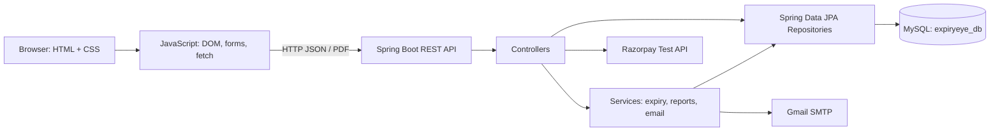

# ExpiryEye — Smart Expiry & Renewal Tracker

ExpiryEye helps users track expiry dates for household items, medicines, insurance, warranties, vehicle documents, and recharge plans. It provides a dashboard, search/filter/sort, expiry calculations, reminder emails, PDF reporting, and eligible renewal/payment flows.

## Technology

- **Frontend:** HTML5, CSS3, vanilla JavaScript (ES6+), DOM events, `fetch()` / `async` / `await`
- **Backend:** Java 17, Spring Boot 3.1.5, Spring Web, Spring Data JPA
- **Database:** MySQL (XAMPP-compatible local setup)
- **Testing:** JUnit 5
- **Additional integrations:** Gmail SMTP, iText PDF, Razorpay test-mode API

## Architecture



See [docs/architecture.md](docs/architecture.md) for the standalone architecture diagram.

## Requirements

- Java 17+
- MySQL 8+ (or XAMPP MySQL)
- Maven 3.8+
- A browser
- Optional: Gmail SMTP App Password for email alerts; Razorpay test keys for payment/renewal flows

## Setup and run locally

### 1. Configure MySQL

1. Start MySQL in XAMPP.
2. Create the database `expiryeye_db`, or let the JDBC URL create it.
3. The default local configuration uses `root` with an empty password. If your local MySQL differs, set `DB_USERNAME`, `DB_PASSWORD`, and optionally `DB_URL`.

### 2. Configure optional integrations securely

Do not commit real credentials to source control. Set these environment variables in the terminal that will run the backend:

**Windows PowerShell example**
```powershell
$env:DB_USERNAME = "root"
$env:DB_PASSWORD = ""
$env:MAIL_USERNAME = "your-email@example.com"
$env:MAIL_PASSWORD = "your-new-gmail-app-password"
$env:RAZORPAY_KEY_ID = "your-razorpay-test-key-id"
$env:RAZORPAY_KEY_SECRET = "your-razorpay-test-secret"
```

Email and Razorpay credentials may be left unset for local UI/database testing, but the corresponding integrations will not work until configured. Never put real credentials in `application.properties`, screenshots, or GitHub commits.

### 3. Start the Java backend

From the project root:

```bash
cd backend
mvn clean test
mvn spring-boot:run
```

The API listens on `http://localhost:8080`.

### 4. Start the frontend

Open `frontend/index.html` using VS Code Live Server (recommended), usually at `http://127.0.0.1:5500`. Keep the backend running in another terminal.

## REST API endpoints

| Method | Endpoint | Purpose |
|---|---|---|
| POST | `/api/users/signup` | Register a user |
| POST | `/api/users/login` | Log in |
| GET | `/api/items/user/{userId}` | List a user's items |
| POST | `/api/items` | Create an item |
| PUT | `/api/items/{id}` | Update an item |
| DELETE | `/api/items/{id}` | Delete an item |
| GET | `/api/items/reorder/{id}` | Extend an item's expiry/validity |
| GET | `/api/dashboard` | Dashboard summary |
| GET | `/api/reports/waste` | Waste/value report |
| GET | `/api/reports/pdf` | Download PDF report |
| GET | `/api/test-email` | Trigger email test endpoint |
| POST | `/api/payments/create-order` | Create a Razorpay test order |
| POST | `/api/payments/verify` | Verify a Razorpay payment |

## Current smart features

- Calculate days remaining and expiry status.
- Show medicine-specific safety warning for expired medicine.
- Search, filter, and sort items in the browser.
- Category-specific reminder windows and renewal/extension flows.
- Daily scheduled email checks at 9:00 AM according to the backend server's local timezone.
- PDF report generation.
- Accessible dashboard loading/error status for item fetches.

## Tests

The current source test suite contains six JUnit tests for expiry-status boundaries and medicine safety warnings. Run `mvn test` from `backend/` before submitting and record the actual result. Do not claim a passing build unless it was run successfully in your environment.

## Real-user test evidence

The hackathon asks for at least three real people from the target user group to try the app. Record their feedback and one change made because of it. Use genuine results only:

| Tester (first name/alias) | Task tried | Feedback | Change made |
|---|---|---|---|
| Tester 1 | Add and find an item | Fill after testing | Fill after implementing |
| Tester 2 | Check expiry/reminder state | Fill after testing | Fill after implementing |
| Tester 3 | Try a report or renewal flow | Fill after testing | Fill after implementing |

## Git history requirement

The hackathon requires commits on at least six different days within a 15-day period. Preserve your existing Git repository when applying these files and continue making genuine, meaningful commits as work is completed. Do not manufacture backdated commits or claim this requirement is met unless `git log` proves it.

## Security notes

- Mail and Razorpay credentials are read from environment variables, not committed properties.
- Passwords are hashed with BCrypt on new signups. Existing legacy plain-text passwords are upgraded to BCrypt after a successful login.
- Authentication responses omit passwords.
- This is a student/demo application, not production-hardened authentication: API endpoints still need proper server-side session/token authentication and authorization before public deployment. Do not deploy it with public access as-is.

## Before submission checklist

- [ ] Start MySQL and confirm saved data survives a backend restart.
- [ ] Run `mvn clean test` from `backend/` and save the real output.
- [ ] Test signup/login, add/edit/delete item, dashboard, report, email (if configured), and payment test flow.
- [ ] Ask three real users to try the app and document actual feedback.
- [ ] Add screenshots and verify README run instructions.
- [ ] Verify six distinct commit dates in the existing Git history.
- [ ] Ensure no secrets are committed.
