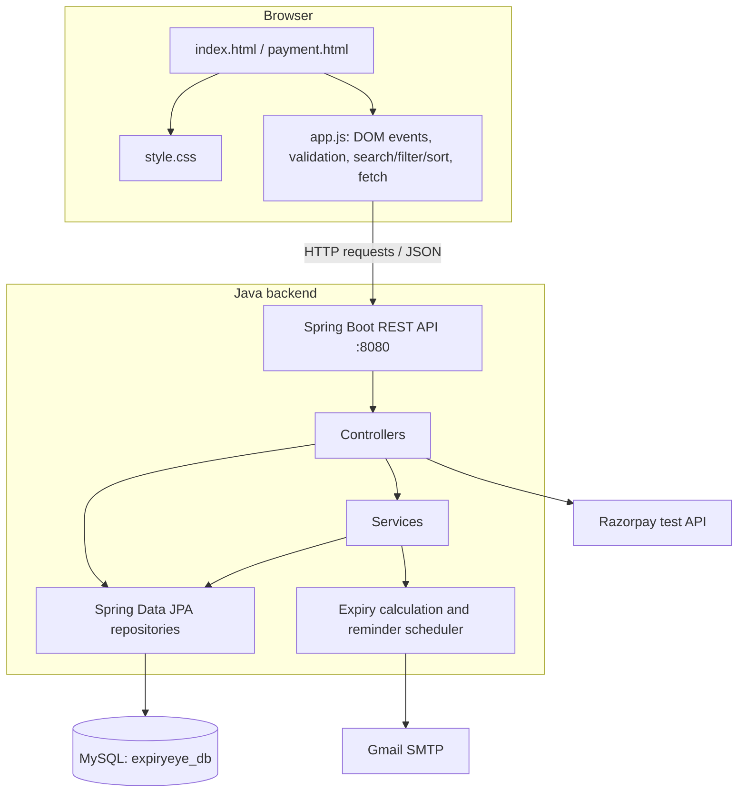

# ExpiryEye — Architecture Diagram

Browser → JavaScript → REST API → Java controllers/services → JPA repositories → MySQL.

External integrations: scheduled expiry email reminders use Gmail SMTP; eligible payment/renewal flows use Razorpay test mode.
